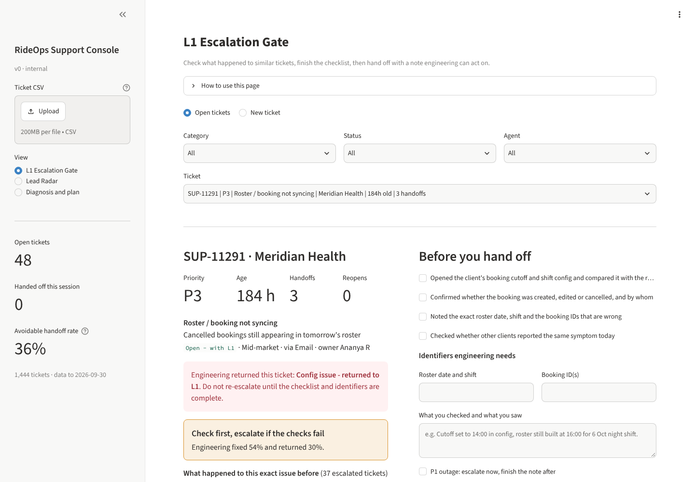
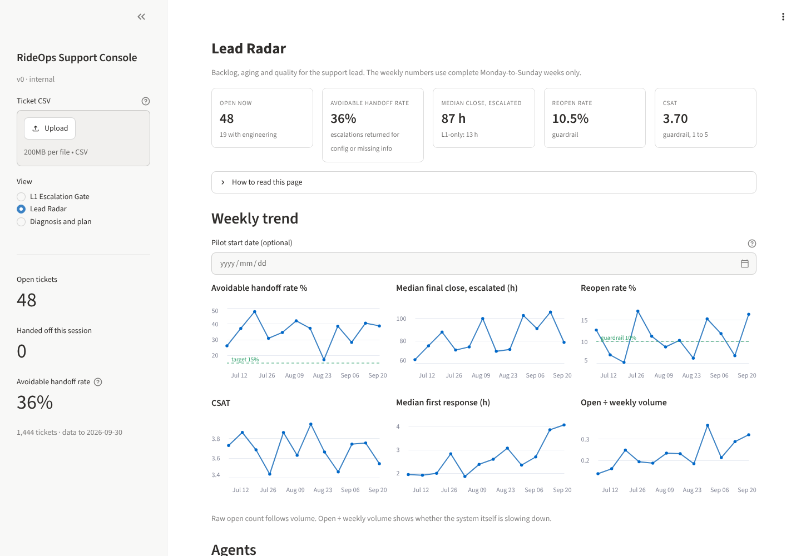

# RideOps Support Console (v0)

Internal tool built for the RideOps support case study. It targets one measure: **avoidable handoffs** (escalations that engineering returns to L1 for config or missing information).



| View | User | Purpose |
|---|---|---|
| L1 Escalation Gate | L1 agent | See how similar tickets ended, link to a known issue, finish a checklist, hand off with a note engineering can act on |
| Lead Radar | Support lead | Backlog, weekly trend against targets, pilot before/after, agent coaching table |
| Diagnosis and plan | Head of Ops | The numbers behind the diagnosis, the claims tested, an impact estimate and the four-week plan |



## What the L1 agent can do
- **Verdict** from historical outcomes of the same issue (or its category when the issue has fewer than 10 escalations).
- **Known-issue matcher**: if engineering already has the same issue open, link the ticket to it instead of raising a new one.
- **Checklist, identifiers and findings** are required before the handoff note unlocks (P1 outage override available).
- **Hand off to Engineering** creates a simulated engineering ID, moves the ticket to "Open - with Engineering" and logs it.
- **Engineering response (simulated)** lets you record Fixed, Returned and so on, so the scorecard moves. Returned tickets come back to L1, others close.
- **New ticket** adds a simulated open ticket to the queue.
- Activity log and an updated tickets CSV can be downloaded.

All of this is session-only. Nothing is written to the CSV or to any external system. The Diagnosis view always uses the original file, so session activity never changes the case-study numbers.

## Run locally
```bash
pip install -r requirements.txt
streamlit run app.py
```
Upload `rideops_support_tickets.csv` in the sidebar, or put it at `data/rideops_support_tickets.csv`. A file with the wrong columns is rejected with a message.

## Deploy on Streamlit Community Cloud
1. Push this folder to GitHub. The case data is confidential, so `data/*.csv` is git-ignored: make the repo private, or upload the CSV in the sidebar after deploying.
2. On share.streamlit.io choose **New app**, pick the repo and set the main file to `app.py`.
3. If the repo is private and you want the CSV bundled, remove the `data/*.csv` line from `.gitignore`.

## Metrics
- **Avoidable handoff rate** (primary): escalations returned to L1 as "Config issue" or "Insufficient info", divided by escalations that have an engineering outcome. Target below 15%.
- **Median time to final close, escalated tickets** (outcome).
- **Guardrails**: reopen rate, CSAT, median first response.

## Assumptions
- Checklists and required identifiers are a proposal to validate with engineering.
- Verdicts are historical rates, not a prediction model.
- The impact estimate in the Diagnosis view is indicative. It assumes an avoided return takes the average time of a clean engineering fix, or of an L1-only ticket for the share L1 now resolves, and converts hours saved to fewer open tickets as hours saved ÷ hours in the period.
- Data was pulled on 30 Sep 2026, so the latest partial week is left out of the weekly charts.
